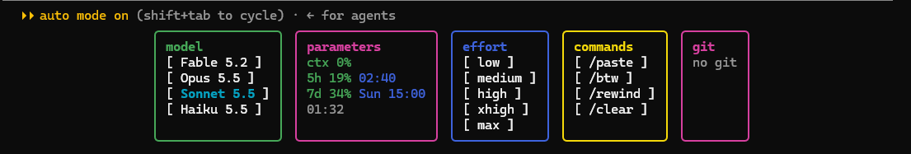

# Terminal Mods

A marketplace of mods for Claude Code. It has one mod for now: `model-effort`.

## The `model-effort` mod

The mod adds a panel of buttons above the Claude Code input line. You do not need to type `/model` and `/effort` by hand: click a button with the mouse.



The panel has five boxes:

- **model** — a list of models: Fable 5.2, Opus 5.5, Sonnet 5.5, Haiku 5.5. Click a model, and the mod runs `/model` with its ID. The current model is highlighted in cyan.
- **parameters** — usage counters:
  - `ctx` — the percentage of the context window in use;
  - `5h` — the percentage of the 5-hour limit used, and the time the limit resets;
  - `7d` — the same for the 7-day limit, with the day of the week it resets;
  - the bottom line — the current time.

  The number changes color from green to yellow and red when a limit is near. If no data is available, the box shows `--%`.
- **effort** — the model effort level: `low`, `medium`, `high`, `xhigh`, `max`. Click a level, and the mod runs `/effort`. The selected level is highlighted in cyan.
- **commands** — quick commands:
  - `/paste` — inserts the clipboard text into the input line;
  - `/btw` — inserts `/btw ` into the input line, and you type the question after it;
  - `/rewind` — runs `/rewind`;
  - `/clear` — runs `/clear`.
- **git** — the first five branches of the git repository in the current folder. If there is no repository, the box shows `no git`.

## Requirements

- Windows. The `/paste` button reads the clipboard through Windows PowerShell.
- Claude Code version 2.1.325 or later.

## Installation

Type the commands in the Claude Code input line, not in PowerShell. Administrator rights are not required.

1. Start Claude Code.
2. Add the GitHub repository as a marketplace:
   ```
   /plugin marketplace add shleyger-dotcom/Terminal-Mods
   ```
3. Install the mod:
   ```
   /plugin install model-effort@terminal-mods
   ```
4. Reload the plugins:
   ```
   /reload-plugins
   ```
   If the boxes do not appear, restart Claude Code.

To get a new version of the mod, update the marketplace:
```
/plugin marketplace update terminal-mods
```

## Check

1. Type `/plugin`. `model-effort` must be in the list of installed plugins.
2. Click a model in the model box. The `/model` command must run.

## Troubleshooting

- Error "marketplace already exists": a marketplace with this name is already added. You do not need to install it again.
- The boxes are doubled: two copies of `model-effort` are installed. Disable one copy with `/plugin`.

## Author

Shleyger Ram
